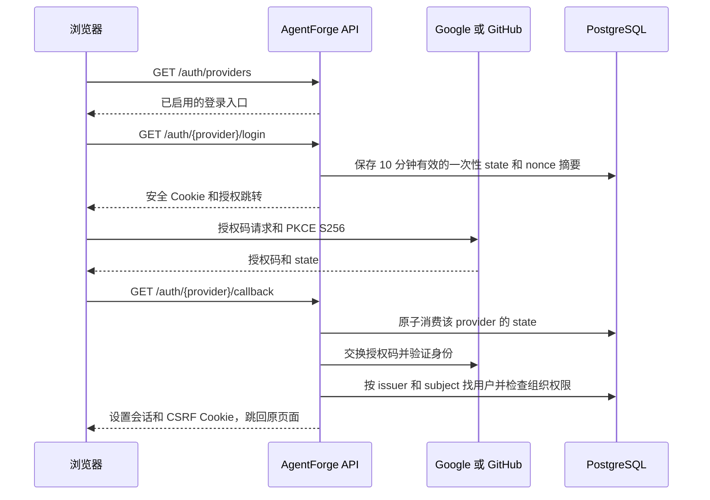

# Google 和 GitHub 单点登录

## 登录流程

- Google 使用现有 OIDC 发现和 ID Token 校验，验证签名、issuer、audience、有效期及 nonce。身份键是 `https://accounts.google.com` 和 `sub`。
- GitHub 使用 OAuth App 和 PKCE S256。后端以令牌请求 `/user` 获取数值 ID，再用 `user:email` 请求 `/user/emails`，仅采用已验证的主邮箱。身份键是 `https://github.com` 和十进制用户 ID。令牌只用于本次回调。
- 各 provider 使用独立回调和事务命名空间。事务 Cookie 使用 `Secure`、`HttpOnly`、`SameSite=Lax` 和 `__Host-`。跳转目的地仅接受同源绝对路径，未传入时返回应用首页。
- 保留已经建立的身份映射。邮箱用于资料和邀请匹配，新身份不会通过邮箱自动继承现有账号权限。新身份仅通过活动组织成员资格或有效邀请获得会话。首次组织 owner 继续由运营方按 issuer 和 subject 引导初始化。

## 接口与界面

| 接口 | 行为 |
| --- | --- |
| `GET /auth/providers` | `200` JSON `{"providers":[{"id":"google","login_url":"/auth/google/login"}]}`。实际列表按 Google、GitHub、旧 OIDC 排序，关闭全部时返回空数组。 |
| `GET /auth/google/login` 和 `GET /auth/github/login` | 启动授权，可传 `return`。未配置的入口返回 `503`。 |
| `GET /auth/google/callback` 和 `GET /auth/github/callback` | 成功返回 `303` 到应用。失败跳回 `/login?sso_error=<code>`，只携带固定错误码和通过校验的 `return`。 |
| `GET /auth/oidc/login` 和 `GET /auth/oidc/callback` | 保留现有企业 OIDC 集成和回调错误响应。 |
| `GET /auth/invitations/accept?token=…` | 短期邀请 Cookie。启用命名 provider 时转到 `/login?invitation=1` 选择入口，仅配置旧 OIDC 时保留直接跳转。 |

登录和注册沿用表单卡片。密码表单位于顶部，分隔线和按顺序排列的 SSO 按钮位于下方。窄屏依旧是单列，按钮为原生键盘可操作链接。加载和空列表不显示分隔线。列表加载失败显示可读提示，密码表单仍可操作。登录页用同一套中英文文案展示邀请和拒绝、登录失败、无组织权限、邀请无效、暂不可用等状态。错误使用可被辅助技术读出的通知。已登录用户打开邀请链接仍可进入选择页。

## 配置、发布与验收

- 用 `GOOGLE_OAUTH_CLIENT_ID` 和 `GOOGLE_OAUTH_CLIENT_SECRET` 配置 Google，用 `GITHUB_OAUTH_CLIENT_ID` 和 `GITHUB_OAUTH_CLIENT_SECRET` 配置 GitHub。各组独立启用。回调在 `APP_ORIGIN` 下，部署时在两家的应用设置里注册精确地址。`OIDC_*` 继续支持现有 provider。
- 先部署到测试环境后逐一配置 provider，用分别具有活动成员资格和有效邀请的账号验证成功返回、拒绝提示及会话。撤掉对应的配置对并重启即可关闭入口，已有应用会话按原有效期运行。
- 并行实现后统一集成。后端身份组覆盖 PKCE、一次性回调、跨 provider 隔离、声明验证、邀请和会话门禁。前端组覆盖启用列表、双语文案、原路返回参数和空/错误状态。主工作树负责配置、路由、身份存储、运行文档和集成验收。
- 使用模拟上游验证协议，再运行 PostgreSQL 测试、后端编译、前端单测/构建及 Playwright 登录旅程。需要目标环境真实 OAuth 应用凭证才能完成上线验收。

## 官方协议文档

- [Google OpenID Connect](https://developers.google.com/identity/openid-connect/openid-connect)
- [GitHub OAuth App 授权](https://docs.github.com/en/apps/oauth-apps/building-oauth-apps/authorizing-oauth-apps)
- [GitHub 用户邮箱 API](https://docs.github.com/en/rest/users/emails)
